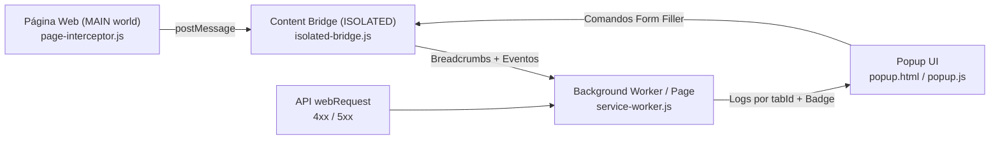

<div align="center">


# QA Pocket

**Extensão multi-navegador (Manifest V3) para QA e times de engenharia: capture evidências de bug com 1 clique e quebre validações de formulário usando dados de borda.**


</div>

---

## O problema que resolve

Times pequenos e QAs perdem tempo abrindo o DevTools para copiar erros de console, caçar requisições `4xx`/`5xx`, anotar resolução/navegador e preencher formulários repetitivos com cenários extremos.

O **QA Pocket** reúne duas ferramentas no mesmo popup, rodando em segundo plano sem build step obrigatório:

1. **🐛 One-Click Bug Reporter** — captura automaticamente erros de console, falhas HTTP (`4xx`/`5xx`), metadados do ambiente, breadcrumbs das últimas interações e screenshot da aba, exportando pronto para **GitHub Issues (Markdown)**, **Jira (Wiki Markup)** ou **Playwright (`.spec.ts`)**.
2. **🧪 Edge-Case Form Filler** — detecta semanticamente os campos da página e preenche formulários com **1 clique** usando dados extremos ou dados brasileiros matematicamente válidos/inválidos (CPF, CNPJ, CEP, telefone, datas, XSS/SQLi probes, emojis e textos gigantes).

---

## Funcionalidades

### 🐛 Bug Reporter (1-Click)
- **Captura passiva por aba**: registra `console.error`, `console.warn`, exceções não tratadas (`window.onerror`), `unhandledrejection` e falhas ao carregar ``/`<script>` antes mesmo de você abrir o popup.
- **Monitoramento HTTP (`4xx` / `5xx` / Rede)**: intercepta `window.fetch` e `XMLHttpRequest` (capturando método, status, duração em ms e trecho da resposta) e complementa com `webRequest` sem duplicar eventos.
- **Breadcrumbs sanitizados**: grava os últimos cliques, preenchimentos e navegações SPA para preencher os *Passos para Reproduzir* e o rascunho Playwright (nunca registra valores de campos `password`).
- **Segurança por padrão**: mascara automaticamente parâmetros sensíveis na URL (`token`, `api_key`, `access_token`, `secret`, `jwt`, `password`).
- **Screenshot integrado**: captura a aba visível, exibe miniatura e permite baixar ou copiar o `.png`.
- **3 formatos de exportação**:
  - **Markdown (GitHub Issues)** com blocos `<details>` expansíveis.
  - **Jira Wiki Markup** pronto para colar em tickets.
  - **Playwright (`.spec.ts`)** com `viewport`, passos capturados e assertions para `consoleErrors` e `failedResponses`.

### 🧪 Edge-Case Form Filler (1-Click)
- **Detecção semântica de campos**: reconhece CPF, CNPJ, CEP, telefone, e-mail, data, número/orçamento, URL, senha, `select`, `checkbox`, `radio`, `textarea` e `contenteditable`.
- **Compatível com React, Vue e Angular**: aplica valores via setter nativo do protótipo DOM e dispara eventos `input`, `change` e `blur`.
- **7 perfis de preenchimento**:
  | Perfil | Objetivo |
  | :--- | :--- |
  | 🌪️ **Caos (Misto)** | Mistura dados extremos, emojis, inválidos e payloads especiais no mesmo envio. |
  | 📏 **Textos Gigantes** | Strings de 500 a 2.200+ caracteres para testar overflow de layout e `maxLength`. |
  | 🛡️ **Especiais & XSS/SQLi** | Payloads inofensivos (`<script>`, `' OR '1'='1`, `{{7*7}}`) para checar sanitização. |
  | 🧪 **Emojis & Unicode** | Emojis compostos, Zalgo, *zero-width spaces* e caracteres multibyte. |
  | 🇧🇷 **Dados BR Válidos** | Gera CPF e CNPJ válidos (dígitos verificadores Mod-11), CEP e telefone realistas. |
  | 🚫 **Dados Inválidos** | CPFs com dígito errado, e-mails malformados, espaços em branco e negativos. |
  | ⏱️ **Datas & Números Extremos** | `1900-01-01`, `2099-12-31`, `2000-02-29`, `0`, negativos e valores gigantes. |
- **Gerador Rápido**: botões de 1 clique no popup para copiar CPF válido, CPF inválido, CNPJ válido, e-mail de borda, payload XSS/SQLi, emojis ou texto de 500 caracteres.

---

## Como funciona por baixo dos panos



- **[`src/shared/webext.js`](src/shared/webext.js)** abstrai diferenças entre `chrome.*` (callbacks + `lastError`) e `browser.*` (Promises), além de fazer fallback de `storage.session` para `storage.local`.
- Em navegadores que não suportam `"world": "MAIN"` no manifesto (como Safari), [`isolated-bridge.js`](src/content/isolated-bridge.js) detecta automaticamente a ausência do marcador DOM e injeta `page-interceptor.js` via `web_accessible_resources`.

---

## Compatibilidade entre navegadores

| Navegador | Status | Pasta de build (`npm run build`) |
| :--- | :--- | :--- |
| **Google Chrome / Edge / Brave / Opera / Vivaldi** | ✅ Suportado (MV3 Service Worker + `world: MAIN`) | `dist/chromium/` |
| **Mozilla Firefox 128+ (Desktop / Android)** | ✅ Suportado (`background.scripts` + `gecko` ID) | `dist/firefox/` |
| **Apple Safari (macOS / iOS)** | ✅ Suportado (fallback automático de injeção) | `dist/safari/` |

---

## Instalação e uso

### 1. Gerar builds por navegador (recomendado)

Requer apenas **Node.js 18+** (zero dependências externas):

```bash
npm run build
```

Isso cria `dist/chromium/`, `dist/firefox/` e `dist/safari/` com o `manifest.json` limpo para cada engine.

### 2. Carregar no navegador

- **Chrome / Edge / Brave / Opera / Vivaldi**:
  1. Acesse `chrome://extensions` (ou `edge://extensions`, `brave://extensions`).
  2. Ative **Modo do desenvolvedor** → **Carregar sem compactação** (*Load unpacked*).
  3. Selecione a pasta `dist/chromium` (ou a raiz do projeto).
- **Mozilla Firefox**:
  1. Acesse `about:debugging#/runtime/this-firefox`.
  2. Clique em **Carregar extensão temporária…** e escolha `dist/firefox/manifest.json`.
  3. Em `about:addons`, habilite a permissão de acesso aos sites para captura automática em segundo plano.
- **Apple Safari**:
  1. Execute `npm run build`.
  2. Converta o pacote com o Xcode CLI:
     ```bash
     xcrun safari-web-extension-converter dist/safari
     ```

---

## Playground local de testes

O repositório inclui uma página interativa com botões que disparam `console.error`, `console.warn`, exceções, `Promise` rejeitada, endpoints reais `404`/`422`/`500` e um formulário com bugs propositais de validação:

```bash
npm run playground
```

Acesse `http://127.0.0.1:4173` com a extensão carregada para testar o fluxo completo.

---

## Testes automatizados

```bash
npm test
```

Cobre:
- Validadores e geradores Mod-11 de CPF/CNPJ e detecção semântica de campos ([`tests/edge-data.test.js`](tests/edge-data.test.js)).
- Formatação GitHub Markdown, Jira Wiki, Playwright `.spec.ts` e mascaramento de tokens ([`tests/formatters.test.js`](tests/formatters.test.js)).
- Integridade do `manifest.json` e endpoints `200`/`404`/`422`/`500` do playground ([`tests/manifest.test.js`](tests/manifest.test.js)).
- Shim `QAWebExt` (`browser.*` vs `chrome.*`) e geração dos pacotes `dist/chromium`, `dist/firefox` e `dist/safari` ([`tests/cross-browser.test.js`](tests/cross-browser.test.js)).

---

## Estrutura do projeto

```text
qa-pocket-extension/
├── manifest.json                 # Manifest V3 unificado
├── package.json                  # Scripts (test, build, playground)
├── icons/                        # Ícones 16x16, 48x48 e 128x128
├── scripts/
│   └── build-browsers.mjs        # Gera builds limpos em dist/
├── src/
│   ├── background/
│   │   └── service-worker.js     # Fila de logs por aba, webRequest, badges e screenshot
│   ├── content/
│   │   ├── page-interceptor.js   # Hooks de console, erros, fetch, XHR e SPA
│   │   └── isolated-bridge.js    # Breadcrumbs, bridge e Edge-Case Form Filler
│   ├── popup/
│   │   ├── popup.html
│   │   ├── popup.css
│   │   └── popup.js              # Interface dual-tab do popup
│   └── shared/
│       ├── webext.js             # Abstração multi-navegador (Chrome/Firefox/Safari)
│       ├── formatters.js         # Geradores Markdown, Jira e Playwright
│       └── edge-data.js          # Perfis de borda e geradores CPF/CNPJ/CEP
├── playground/                   # Ambiente local para testar bugs e formulários
└── tests/                        # Suíte node:test (14 testes)
```

## Licença

MIT
